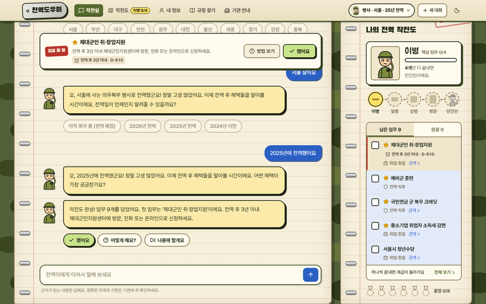
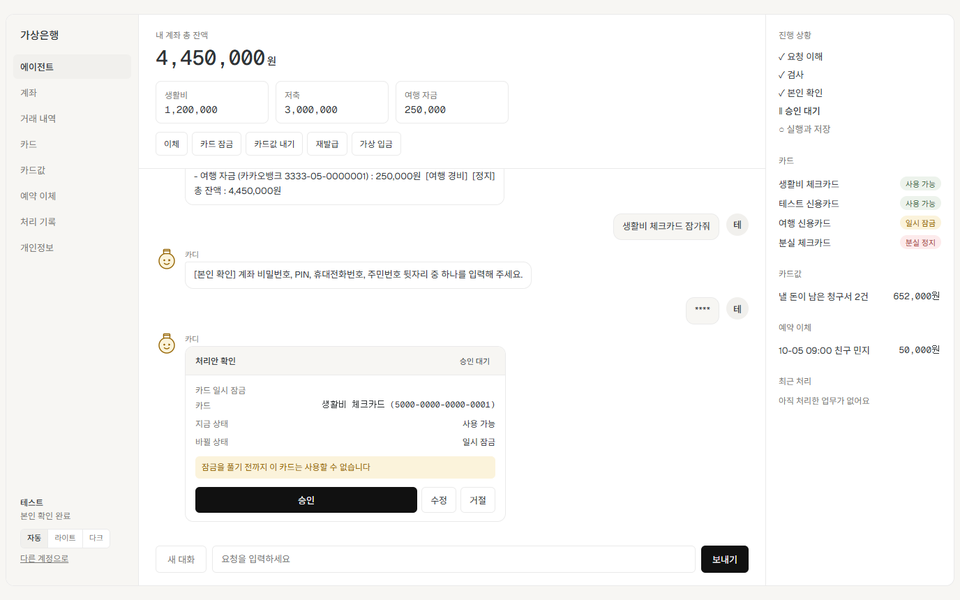
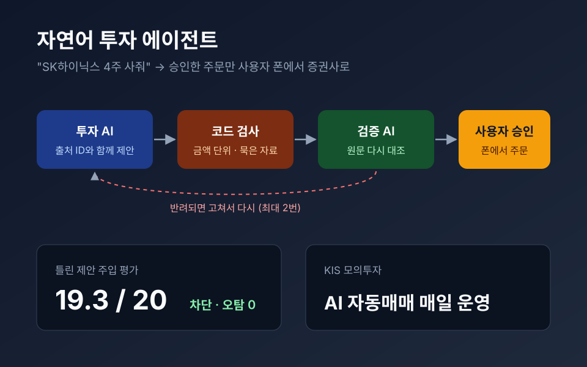

**검증 가능한 AI 에이전트**와 **실제로 쓰이는 서비스**를 만듭니다. 
돈 · 상태가 바뀌는 일은 사람의 승인을 거치게 하고, AI의 답은 원문 근거와 다시 대조합니다.

 

## ✨ 대표 프로젝트

<table>
  <tr>
    <td width="33%" valign="top" align="center">
      
      <h4>🪖 전역도우미 </h4>
      전역자 혜택을 <b>법령 근거</b>와 함께 찾아 할 일로 이어 주는 에이전트 
      <b>10,143조각 하이브리드 RAG</b> + <b>MCP</b> 공공 API 
      답변 평가 <b>202/205</b> · Recall@6 100% · RAGAS 0.879 
      근거 원문 보기 · 신청 서류 · 기한 알림  
      <code>LangGraph</code> <code>pgvector</code> <code>MCP</code> <code>RAGAS</code> 
      <a href="https://github.com/snail5039-code/jeonyeok_helper"><b>저장소 →</b></a>
    </td>
    <td width="33%" valign="top" align="center">
      
      <h4>🏦 가상 금융 업무 에이전트 </h4>
      계좌 · 카드 업무를 <b>본인 확인 → 처리안 → 승인</b>으로 처리 
      Golden Set 40개 <b>세 평가 모두 40/40</b>  
      <code>LangGraph</code> <code>LangSmith</code> <code>FastAPI</code> 
      <a href="https://github.com/snail5039-code/virtual_bank_agent"><b>저장소 →</b></a>
    </td>
    <td width="33%" valign="top" align="center">
      
      <h4>📈 자연어 투자 에이전트 </h4>
      <b>투자 AI 제안 → 검증 AI 대조 → 사용자 승인</b> 뒤에만 주문 
      틀린 제안 <b>19.3/20 차단</b> 
      모의 자동매매 6일 −5.71% (코스피 −16.69%) · 로직 40개+ 수정  
      <code>LangGraph</code> <code>FastAPI</code> <code>Flutter</code> 
      <a href="https://github.com/snail5039-code/financial-ai-agent"><b>저장소 →</b></a>
    </td>
  </tr>
</table>

**그 밖에** &nbsp;·&nbsp; [⏰ 출퇴근 생존일지](https://commute-battle.vercel.app) 근태 관리 서비스 (배포) &nbsp;·&nbsp; [🤖 커리마](https://github.com/snail5039-code/personal-financial-management/releases/tag/v1.1.0-installer) 개인비서 CLI (설치 파일) &nbsp;·&nbsp; [🌡️ 온열질환자 수 예측](https://web-wine-one-11.vercel.app/) ML 서비스 (배포)

**[전체 프로젝트와 트러블슈팅은 포트폴리오에서 →](https://github.com/snail5039-code/portfolio)**

## 🛠 Tech Stack

 
  

## 🌱 요즘

- AI 에이전트 엔지니어 트랙을 수강하며 [TIL](https://github.com/snail5039-code/TIL)에 매일 기록합니다.
- 실습: [한국어 문서 RAG Agent](https://github.com/snail5039-code/rag_agent_practice) — PDF 59개 근거 답변, 근거 없으면 보류, 정답률 0.79 → 0.90 (3인 실습)
- 만든 제품과 개발 기록은 [HyukForge](https://hyukforge.vercel.app)에 올립니다.

